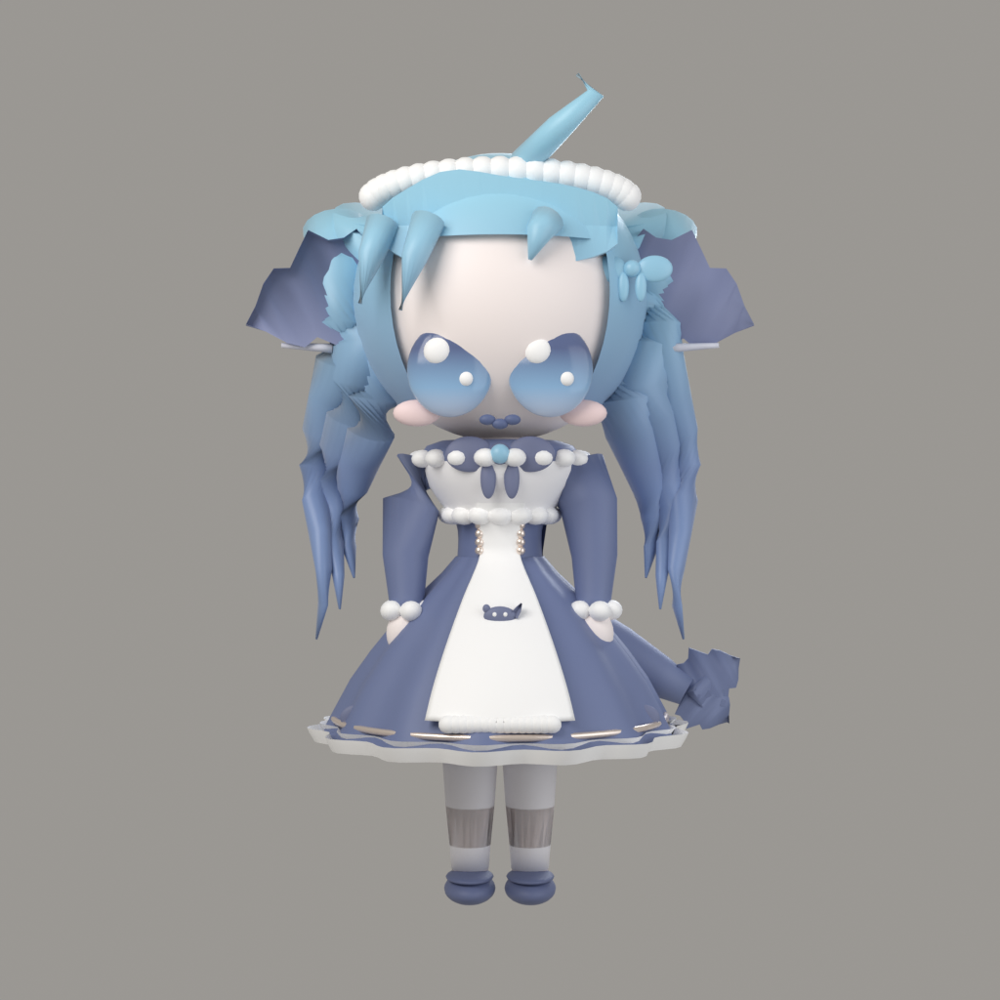

# 鲸鱼娘 3D 模型（semi-chibi）

> DeepSeek 鲸鱼娘（Whale-chan）的**参数化三维重建** —— 从 2D 角色参考图反推建模，
> 全流程可复现：参考图 → 比例量测 → 程序化生成 → 同机位渲染验收 → 导出。



---

## 规格

| 项 | 值 |
|---|---|
| 形态 | **semi-chibi**（Q 版） |
| 头身比 | **2.867**（规范区间 2.695 – 2.995 ✅） |
| 总高 | 2.8726 BU（1 头身 = 1.0 BU） |
| 宽 × 深 | 1.8204 × 0.7104 BU |
| 逻辑对象 | 28 个 / 原始部件 235 个 |
| 建模方式 | 全参数化（bpy 程序化几何），无手工雕刻 |
| 渲染 | Cycles CPU，正视图 / 侧视图 / 3-4 视角 |

### 标度约定

- Z 轴向上，原点在脚底中心，正面朝 **-Y**
- **1 头身 = 1.0 BU**，即头高（头顶到下巴）= 1.0，总高 = 2.87
- 实际尺寸按需整体缩放；模型内所有部件共用同一坐标系

---

## 文件

```
whale-chan-3d/
├── model/
│   ├── whale-chan.blend          # Blender 4.2 工程文件（可编辑源）
│   ├── whale-chan.glb            # glTF 2.0 二进制（通用导入）
│   └── scripts/
│       ├── SPEC.md               # 冻结的建模规格（唯一真源）
│       ├── walechan_geom.py      # 几何工具层：lathe / tube / ribbon / cyl_patch …
│       ├── walechan_parts.py     # 部件装配层：28 个部件
│       ├── run_build.py          # 入口：构建 → 验收 → 渲染 → 导出
│       └── verify_outputs.py     # 独立验收：G1–G6 全检（产物 + 渲染图）
├── renders/
│   ├── whale-chan-front.png
│   ├── whale-chan-side.png
│   └── whale-chan-three-quarter.png
├── reference/
│   ├── SOURCES.md                # 参考素材来源 + SHA-256
│   └── fetch_reference.py        # 按需下载并校验参考图
├── NOTICE.md                     # 署名链与许可（必读）
└── README.md
```

---

## 使用

### Blender

直接打开 `model/whale-chan.blend`（Blender 4.2+）。

### glTF / 其他引擎

导入 `model/whale-chan.glb`。包含完整层级、材质槽与 PBR 材质；
发色使用 Object 坐标 Z 渐变（根 `#3a5593` → 中 `#344b88` → 梢 `#58a7d3`），
在支持 Object 坐标的引擎中可直接还原；如不支持渐变，会退化为梢部单色。

### 重新生成

```bash
pip install bpy==4.2.0          # 或用官方 Blender 4.2 内置 Python
python reference/fetch_reference.py --dest reference
cd model/scripts
python run_build.py --samples 96 --res 900 --out ../out
```

产物：`out/whale-chan.blend`、`out/whale-chan.glb`、`out/renders/*.png`、`out/verify.json`

### 验收门

`run_build.py` 内建 G1–G3 几何检查并写出 `verify.json`；
`verify_outputs.py` 是**独立验收脚本**，额外覆盖 G4（渲染占比）与 G5（导出格式）：

```bash
python3 model/scripts/verify_outputs.py --out out
# → 逐项打印 G1–G6 判定，全通过则退出码 0
```

| 门 | 判据 |
|---|---|
| G1 头身比 | 总高/头高 ∈ [2.695, 2.995] |
| G2 部件齐全 | 逻辑对象 ≥ 20 |
| G3 材质 | 无空网格、无缺材质网格 |
| G4 渲染 | 三视角成图，≥1024²，角色占画面高度 75–92% |
| G5 导出 | `.blend` 头合法 + `.glb` magic=`glTF`/v2，JSON chunk 可解析 |
| G6 退出码 | 作业 exit code = 0 |

---

## 建模思路

参考 `dsh-blender-plugin` 的「参考图通用还原 SOP」：**先量测，再放样，最后同机位验收**。

1. **量测** —— 从 1024×1024 参考图按像素提取角色包围盒与行宽剖面，
   换算成 BU 锚点（头顶 / 眼心 / 下巴 / 肩 / 腰 / 裙摆 / 膝 / 脚底）。
2. **配色** —— 对参考图做主色聚类，取发色渐变端点与裙/蕾丝/描边色，
   与上游 `CHARACTER.md` 官方色号交叉校验。
3. **生成** —— 全部部件由参数化几何构成：
   回转体（`lathe` / `lathe_wave`）做躯干与裙，变半径管（`tube`）做发束与鲸尾，
   曲面带（`ribbon`）做刘海帘，圆柱面片（`cyl_patch`）做围裙，
   鱼鳍片（`fin_blade`）做鳍耳与尾鳍。
4. **材质** —— Principled BSDF，发色与眼睛用 Object 坐标 Z 驱动 ColorRamp 渐变。
5. **验收** —— Cycles CPU 出正/侧/3-4 三视角，与参考图同机位比对。

### 两个踩过的坑

- **bpy 退出时段错误** —— bpy 在进程退出时析构崩溃，产物已落盘但退出码非零，
  会打断自动化流水线。作业末尾统一走 `quit_blender()` + `os._exit(code)`。
- **`lathe` 的顶点是「圈优先」排列** —— 周向索引 `i*n+k`，封口面连的是轮廓上的 n 个点，
  不是周向的 segs 个。搞错会导致封口面索引越界或模型破面。

---

## 许可

模型产物与渲染图：**CC BY-NC-SA 4.0**，禁止商用。署名链见 [NOTICE.md](NOTICE.md)。
建模脚本：**MIT**。

⚠️ 鲸鱼娘是社区二创形象，著作权与商标分属不同权利人。本项目为非官方衍生创作。
